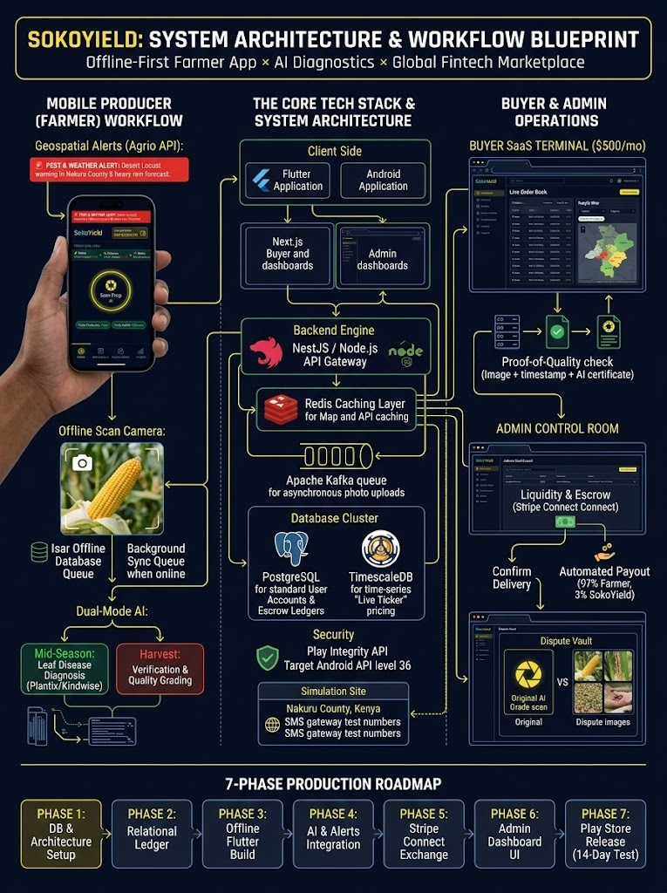

# SokoYield

Offline-first agricultural fintech marketplace: a Flutter farmer app, Next.js buyer/admin dashboards, and a NestJS API gateway.



## Monorepo layout

| Path | What | Tooling |
| --- | --- | --- |
| `apps/mobile` | Farmer app (Flutter, Isar offline DB) | Flutter / Dart *(created after toolchain install)* |
| `apps/web` | Buyer SaaS terminal + Admin Control Room (one Next.js app, role-gated `/buyer`, `/admin`) | Next.js 16, Tailwind v4 |
| `apps/api` | API gateway / microservices | NestJS 12 (ESM), Vitest, oxlint |
| `packages/*` | Shared TS packages (added as needed) | pnpm workspaces |
| `infra/docker` | Local infrastructure | Docker Compose |
| `docs/design` | Architecture blueprint & UI prototype references | - |

## Infrastructure (Docker)

| Service | Image | Port | Purpose |
| --- | --- | --- | --- |
| `postgres` | `timescale/timescaledb:2.21.0-pg17` | 5432 | Relational ledger (users, assets, escrow). TimescaleDB extension is enabled in Phase 5 for the live ticker. |
| `redis` | `redis:7.4-alpine` | 6379 | Weather/GPS/map API cache |
| `kafka` | `apache/kafka:4.1.0` (KRaft) | 9092 | Async queue for offline-synced AI photo uploads |
| `kafka-init` | one-shot | - | Creates platform topics |
| `kafka-ui` *(profile `tools`)* | `kafbat/kafka-ui` | 8082 | Kafka browser |
| `adminer` *(profile `tools`)* | `adminer` | 8081 | Postgres browser |

Kafka topics: `crop.photo.uploaded`, `crop.grade.completed`, `crop.photo.dlq`, `alerts.agro.issued`.

## Prerequisites

- **Node.js 22 LTS or 24 LTS** (the Kafka client ships prebuilt native binaries for LTS releases only)
- pnpm 10 (`npm i -g pnpm@10` or `npx pnpm@10 ...`)
- Docker Desktop
- Flutter SDK (stable) + JDK 17 + Android SDK - for `apps/mobile`

## Getting started

```bash
cp .env.example .env
pnpm install
pnpm infra:up          # postgres, redis, kafka (+ topic creation)
pnpm dev               # API on :4000, web on :3000
```

- API liveness: http://localhost:4000/api/v1/health/live
- API readiness (Postgres + Redis + Kafka): http://localhost:4000/api/v1/health
- Web: http://localhost:3000 (shows live infrastructure status)

## Quality gates

```bash
pnpm lint && pnpm typecheck && pnpm test && pnpm build
pnpm --filter @sokoyield/api test:e2e   # needs `pnpm infra:up`
```

CI (GitHub Actions):
- `.github/workflows/ci-web-api.yml` - lint, typecheck, unit tests, build; API e2e against the real compose stack.
- `.github/workflows/ci-mobile.yml` - Flutter format, analyze, test, Isar codegen, debug APK build.

## Roadmap

1. **DB & architecture setup** <- current
2. Relational ledger & RBAC (Farmer / Buyer / Admin)
3. Offline Flutter build (Cyber-Agronomy UI, Isar queue, Nakuru County simulation)
4. AI & alerts (Plantix/Kindwise dual-mode AI via Kafka, Agrio cron, Twilio SMS)
5. Stripe Connect exchange (manual-payout escrow, 97% farmer / 3% SokoYield, \$500/mo buyer SaaS, TimescaleDB ticker over WebSockets)
6. Admin Control Room (API health, liquidity monitor, dispute vault)
7. Play Store release (API 36, Play Integrity, AAB, 14-day closed test)
